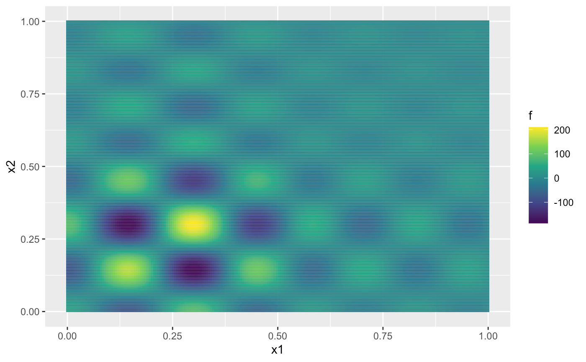
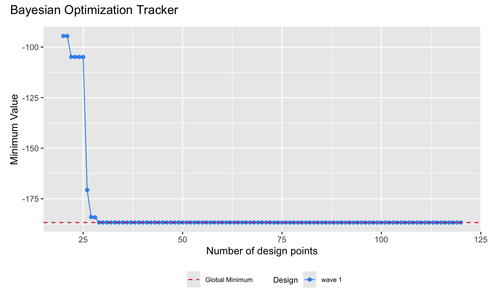
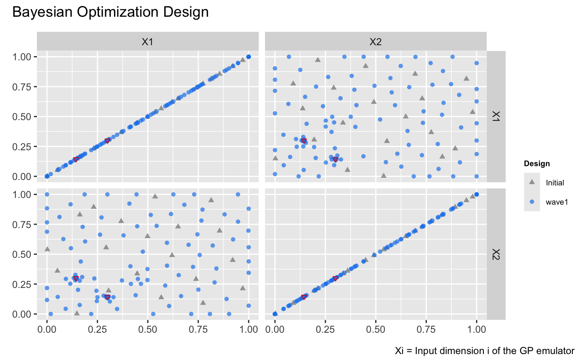

# Bayesian Optimization

This vignette demonstrates how to utilize and repurpose the
[`design()`](http://mingdeyu.github.io/dgpsi-R/dev/reference/design.md)
function in `dgpsi` to implement Bayesian optimization using the (D)GP
surrogate models provided by the package.

## Load the packages

``` r

library(tidyverse)
library(lhs)
library(patchwork)
library(ggplot2)
library(dgpsi)
```

## Define the target function

We consider a version of the Shubert function (Surjanovic and Bingham
2013) defined over the domain $`[0,1]^2`$ as follows:

``` r

shubert <- function(x)
{
  N <- nrow(x)
  x1 <- x[,1] * 4 - 2
  x2 <- x[,2] * 4 - 2
  ii <- c(1:5)
  
  y <- sapply(1:N, function(i) {
    sum(ii * cos((ii+1)*x1[i]+ii)) * sum(ii * cos((ii+1)*x2[i]+ii))
    })
  
  y <- matrix(y, ncol = 1)
  return(y)
}
```

To pass the Shubert function to
[`design()`](http://mingdeyu.github.io/dgpsi-R/dev/reference/design.md),
we defined it such that both its input `x` and output are matrices.
Next, we generate the contour of the Shubert function:

``` r

x1 <- seq(0, 1, length.out = 200)
x2 <- seq(0, 1, length.out = 200)
dat <- expand_grid(x1 = x1, x2 = x2)
dat <- mutate(dat, f = shubert(cbind(x1, x2)))
ggplot(dat, aes(x1, x2, fill = f)) + geom_tile() + 
  scale_fill_continuous(type = "viridis")
```



From the figure above, we can observe that the Shubert function has
several local minima and two global minima located at (0.1437, 0.2999)
and (0.2999, 0.1437), both with values around -186.7309. In the
remainder of this vignette, we will use Expected Improvement (EI) as the
acquisition function to identify the global minima.

## Initial emulator construction

To ensure the reproducibility of this vignette, we set a seed using the
[`set_seed()`](http://mingdeyu.github.io/dgpsi-R/dev/reference/set_seed.md)
function from the package:

``` r

set_seed(9999)
```

Next, we generate an initial design of 20 points using the maximin Latin
hypercube sampler:

``` r

X <- maximinLHS(20, 2)
Y <- shubert(X)
```

to construct the initial DGP surrogate model of the Shubert function:

``` r

m <- dgp(X, Y, name = 'matern2.5')
```

    ## Auto-generating a 2-layered DGP structure ... done
    ## Initializing the DGP emulator ... done
    ## Training the DGP emulator: 
    ## Iteration 500: Layer 2: 100%|██████████| 500/500 [00:01<00:00, 401.58it/s]
    ## Imputing ... done

## Bayesian optimization using Expected Improvement (EI)

To begin Bayesian optimization with
[`design()`](http://mingdeyu.github.io/dgpsi-R/dev/reference/design.md),
we first need to define the Expected Improvement (EI) acquisition
function, adhering to the rules specified for the `method` argument in
[`design()`](http://mingdeyu.github.io/dgpsi-R/dev/reference/design.md):

``` r

ei <- function(object, limits, n_starts = 20) {
  # Best observed minimum value
  best_value <- min(object$data$Y)

  # Expected Improvement (EI) function
  ei_function <- function(x) {
    # Extract mean and variance from the 'object'
    pred <- predict(object, matrix(x, nrow = 1))$results
    improvement <- best_value - pred$mean
    sigma <- sqrt(pred$var)

    # Handle zero variance using deterministic improvement
    if (sigma == 0) return(-max(improvement, 0))

    # Calculate EI, preserving small positive values
    z <- improvement / sigma
    # Return negative EI because optim() minimizes by default
    -max(improvement * pnorm(z) + sigma * dnorm(z), 0)
  }

  # Generate initial points using Latin Hypercube Sampling (LHS)
  starts <- lhs::maximinLHS(n_starts, nrow(limits))
  starts <- sweep(starts, 2, limits[, 2] - limits[, 1], "*")
  starts <- sweep(starts, 2, limits[, 1], "+")

  # Scale the objective, limiting rescaling when initial EI is extremely small
  start_values <- apply(starts, 1, ei_function)
  sigma_scale <- max(sqrt(predict(object, starts)$results$var))
  objective_scale <- max(-start_values, .Machine$double.eps * sigma_scale)
  if (objective_scale == 0) objective_scale <- 1

  # Perform optimization with multiple starts using optim()
  results <- lapply(seq_len(n_starts), function(i) {
    # Retain the evaluated starting point if refinement fails
    fallback <- list(par = starts[i, ], value = start_values[i])
    result <- tryCatch(
      optim(
        par = starts[i, ],
        fn = ei_function,
        method = "L-BFGS-B",
        lower = limits[, 1],
        upper = limits[, 2],
        control = list(fnscale = objective_scale)
      ),
      error = function(e) fallback
    )

    # Keep the best valid point from this start
    if (!is.finite(result$value) || any(!is.finite(result$par)) ||
        result$value > fallback$value) fallback else result
  })

  # Find the result with the minimum (most negative) EI
  best <- which.min(vapply(results, `[[`, numeric(1), "value"))

  # Return the next best point as a single-row matrix
  matrix(results[[best]]$par, nrow = 1)
}
```

The `ei` function defined above takes the emulator as its first
argument, `object`, along with the additional arguments: `limits`, a
two-column matrix where the first column specifies the lower bounds and
the second column specifies the upper bounds of the input dimensions,
and `n_starts`, which defines the number of multi-start points used to
search for the location corresponding to the minimum (most negative) EI.
You can, of course, replace `ei` with your own acquisition function,
provided it adheres to the rules of the `method` argument in
[`design()`](http://mingdeyu.github.io/dgpsi-R/dev/reference/design.md)
(see
[`?design`](http://mingdeyu.github.io/dgpsi-R/dev/reference/design.md)
for details).

To track the identified minimum value of the Shubert function during
Bayesian optimization, we define a monitor function, `opt_monitor`, to
be passed to the `eval` argument of
[`design()`](http://mingdeyu.github.io/dgpsi-R/dev/reference/design.md):

``` r

opt_monitor <- function(object) {
  return(min(object$data$Y))
}
```

The domain of the input for the Shubert function, within which the
global minima are searched by the Bayesian optimization, is defined as
$`[0,1]^2`$:

``` r

lim <- rbind(c(0, 1), c(0, 1))
```

With all the ingredients ready, we can now run the Bayesian optimization
using
[`design()`](http://mingdeyu.github.io/dgpsi-R/dev/reference/design.md)
with 100 iterations:

``` r

m <- design(m, N = 100, limits = lim, f = shubert, method = ei, eval = opt_monitor)
```

    ## Initializing ... done
    ##  * Metric: -94.537224
    ## Iteration 1:
    ##  - Locating ... done
    ##  * Next design point: 0.416102 0.251405
    ##  - Updating and re-fitting ... done
    ##  - Validating ... done
    ##  * Metric: -94.537224
    ## 
    ## ...
    ## 
    ## Iteration 8:
    ##  - Locating ... done
    ##  * Next design point: 0.294140 0.137627
    ##  - Updating and re-fitting ... done
    ##  - Transiting to a GP emulator ... done
    ##  - Validating ... done
    ##  * Metric: -184.184830
    ## 
    ## ...
    ## 
    ## Iteration 100:
    ##  - Locating ... done
    ##  * Next design point: 0.000000 0.766103
    ##  - Updating and re-fitting ... done
    ##  - Validating ... done
    ##  * Metric: -186.730481

During the Bayesian optimization, our dynamic pruning mechanism
transitioned the DGP emulator to a GP emulator at iteration 8, leading
to faster optimizations in the remaining iterations while maintaining
the emulator’s quality. After 100 iterations, we identified a minimum of
the Shubert function with a value of -186.7305, which is very close to
the global minimum of -186.7309. We can inspect the progress of the
minima search conducted by
[`design()`](http://mingdeyu.github.io/dgpsi-R/dev/reference/design.md)
by applying
[`draw()`](http://mingdeyu.github.io/dgpsi-R/dev/reference/draw.md) to
`m`:

``` r

draw(m) +
  plot_annotation(title = 'Bayesian Optimization Tracker') +
  labs(y = "Minimum Value") +
  # Add a horizontal line to represent the global minimum for benchmarking
  geom_hline(
    aes(yintercept = y, linetype = "Global Minimum"), # Global minimum
    data = data.frame(y = -186.7309),
    color = "#E31A1C",
    linewidth = 0.5
  ) +
  scale_linetype_manual(
    values = c("Global Minimum" = "dashed"),
    name = "" # Remove the legend title
  )
```



The figure above shows that Bayesian optimization using our (D)GP
emulator quickly identifies a low value of the Shubert function within 7
iterations. Notably, the lowest value, -186.7305, was achieved by
[`design()`](http://mingdeyu.github.io/dgpsi-R/dev/reference/design.md)
after 76 iterations.

We can also inspect the locations identified during the process by
applying
[`draw()`](http://mingdeyu.github.io/dgpsi-R/dev/reference/draw.md) to
`m` with `type = 'design'`:

``` r

draw(m, type = 'design') + 
  plot_annotation(title = 'Bayesian Optimization Design') +
  # Highlight the global minima on the design plot
  geom_point(
    data = data.frame(
      .panel_x = c("X1", "X2"),  # x labels of panels
      .panel_y = c("X2", "X1"),  # y labels of panels
      X1 = c(0.1437, 0.2999),    # X1 values for the global minima
      X2 = c(0.2999, 0.1437)     # X2 values for the global minima
    ),
    aes(x = .panel_x, y = .panel_y),
    size = 1.25, 
    shape = 6,
    color = "#E31A1C"           
  )
```



The figure above illustrates that Bayesian optimization successfully
identifies the regions around the two global minima, represented as red
inverted triangles, by adding design points concentrated near these two
locations.

### References

Surjanovic, Simon, and Derek Bingham. 2013. *Virtual Library of
Simulation Experiments: Test Functions and Datasets*.
[Https://www.sfu.ca/~ssurjano/index.html](https://www.sfu.ca/~ssurjano/index.html).
