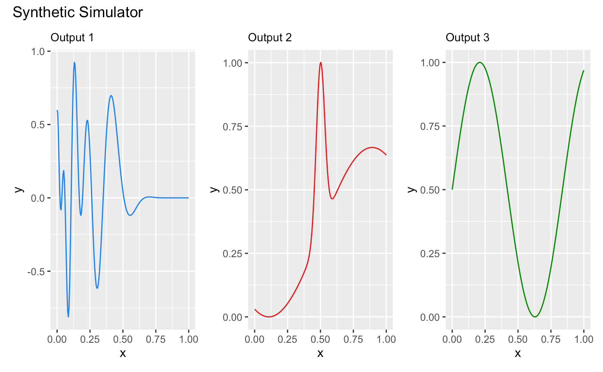
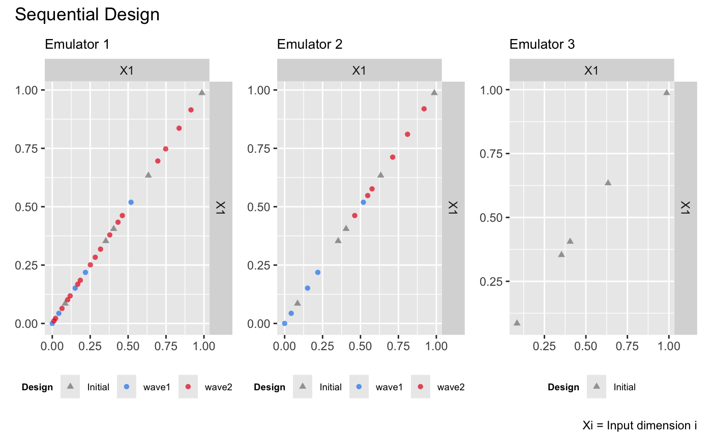
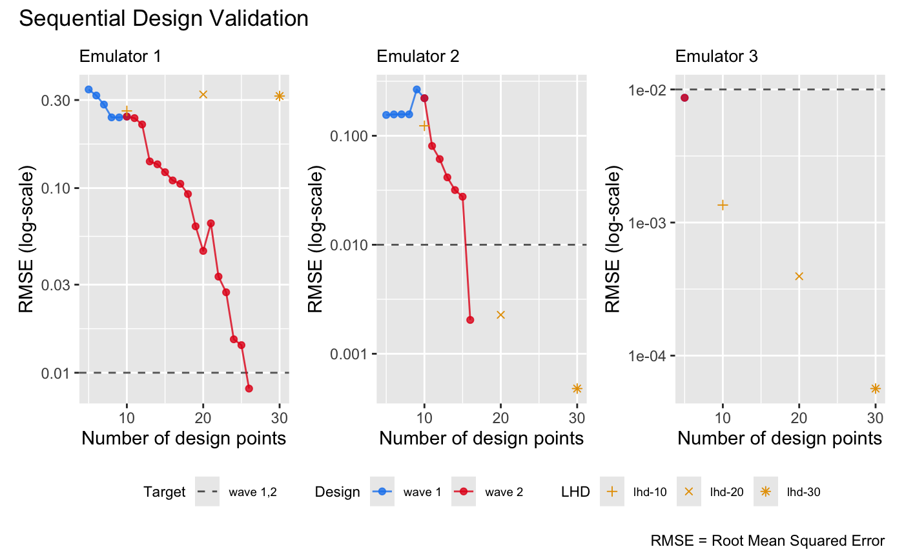

```{r setup, include = FALSE}
knitr::opts_chunk$set(
  echo = TRUE,
  eval = FALSE
)

get_article_url <- function(article) {
  pkg_version <- as.character(utils::packageVersion("dgpsi"))
  
  is_dev <- grepl("\\.9000$", pkg_version)
  
  base_url <- if (is_dev) {
    "https://mingdeyu.github.io/dgpsi-R/dev"
  } else {
    "https://mingdeyu.github.io/dgpsi-R"
  }
  
  paste0(base_url, article)
}
```

This vignette shows how to use the package to sequentially refine a bundle of DGP emulators, each of which emulates an output of a simulator.

## Load the packages

```{r}
library(lhs)
library(ggplot2)
library(patchwork)
library(dgpsi)
```

## Construct a synthetic simulator

We construct a synthetic simulator that has a one-dimensional input between `[0, 1]` and a three-dimensional output.

```{r}
f <- function(x) {
  y1 = sin(30*((2*x-1)/2-0.4)^5)*cos(20*((2*x-1)/2-0.4))
  y2 = 1/3*sin(2*(2*x - 1))+2/3*exp(-30*(2*(2*x-1))^2)+1/3
  y3 = (sin(7.5*x)+1)/2
  return(cbind(y1, y2, y3))
}
```

Note that the function is defined in such a way that both its input, `x`, and output are matrices. The following figure shows the true functional forms of the three outputs of the simulator over $[0, 1]$:

```{r}
dense_x <- seq(0, 1, length = 200)
dense_y <- f(dense_x)
output1 <- data.frame('x' = dense_x, 'y' = dense_y[,1])
output2 <- data.frame('x' = dense_x, 'y' = dense_y[,2])
output3 <- data.frame('x' = dense_x, 'y' = dense_y[,3])
p1 <- ggplot(data = output1, aes(x = x, y = y)) + geom_line(color = 'dodgerblue2') + ggtitle('Output 1') + theme(plot.title = element_text(size = 10))
p2 <- ggplot(data = output2, aes(x = x, y = y)) + geom_line(color = '#E31A1C') + ggtitle('Output 2') + theme(plot.title = element_text(size = 10))
p3 <- ggplot(data = output3, aes(x = x, y = y)) + geom_line(color = 'green4') + ggtitle('Output 3') + theme(plot.title = element_text(size = 10))
wrap_plots(list(p1, p2, p3)) + plot_annotation(title = 'Synthetic Simulator')
```

{width=100%}

We now specify a seed with `set_seed()` from the package for reproducibility

```{r}
set_seed(9999)
```

and generate an initial design with 5 design points using a maximin Latin hypercube sampler:

```{r}
X <- maximinLHS(5, 1)
Y <- f(X)
```

We generate a validation dataset to track and stop the sequential design:

```{r}
validate_x <- maximinLHS(200, 1)
validate_y <- f(validate_x)
```

## Construct a bundle of DGP emulators

Before we start the sequential design, we build three DGP emulators that emulate the three outputs of the simulator `f` independently:

```{r}
m1 <- dgp(X, Y[,1])
```

```
## Auto-generating a 2-layered DGP structure ... done
## Initializing the DGP emulator ... done
## Training the DGP emulator: 
## Iteration 500: Layer 2: 100%|██████████| 500/500 [00:00<00:00, 679.50it/s]
## Imputing ... done
```

```{r}
m2 <- dgp(X, Y[,2])
```

```
## Auto-generating a 2-layered DGP structure ... done
## Initializing the DGP emulator ... done
## Training the DGP emulator: 
## Iteration 500: Layer 2: 100%|██████████| 500/500 [00:00<00:00, 557.33it/s]
## Imputing ... done
```

```{r}
m3 <- dgp(X, Y[,3])
```

```
## Auto-generating a 2-layered DGP structure ... done
## Initializing the DGP emulator ... done
## Training the DGP emulator: 
## Iteration 500: Layer 2: 100%|██████████| 500/500 [00:00<00:00, 550.72it/s]
## Imputing ... done
```

We then build a bundle of the three DGP emulators using `pack()`:

```{r}
m <- pack(m1, m2, m3)
```

## Sequential design for the emulator bundle

To begin sequential design, we first specify the limit of each input:

```{r}
lim <- c(0, 1)
```

and set a target RMSE to stop the sequential design:

```{r}
target <- 0.01
```

Here we choose `0.01` because it is equivalent to `1%` normalized error given that the ranges of both outputs are `[0,1]`. We can set different targets for different outputs, e.g., by setting `target <- c(0.005, 0.02, 0.01)`. 

We start the first wave of the sequential design by defining an aggregation function `g` (applicable to all built-in `method` functions of `design()`), to compute a weighted average of the criterion scores across the three outputs:

```{r}
g <- function(x, weight){
  x[,1] <- x[,1]*weight[1]
  x[,2] <- x[,2]*weight[2]
  x[,3] <- x[,3]*weight[3]
  return(rowSums(x))
}
```

We assign equal weights of `1/3` to the three emulators:

```{r}
weight <- c(1/3, 1/3, 1/3)
```

The aggregation function ensures that, at each step, the same design point is added to all emulators that have not yet reached the target, instead of selecting different design points for each emulator. Using the aggregation approach can reduce the number of simulations required at each iteration, as a single simulator run provides all three outputs at the shared design point.

We now pass both the aggregation function, `g()`, and its `weight` argument to `design()` for a first wave of the sequential design with 5 steps:

```{r}
# 1st wave with aggregation and up to 5 steps
m <- design(m, N = 5, limits = lim, f = f, x_test = validate_x, y_test = validate_y, aggregate = g, target = target, weight = weight)
```

```
## Initializing ... done
##  *  RMSE: 0.342238, RMSE: 0.155150, RMSE: 0.008662
## Iteration 1:
##  - Locating ... done
##  * Next design point (Emulator1): 0.218835
##  * Next design point (Emulator2): 0.218835
##  * Next design point (Emulator3): None (target reached)
##  - Updating and re-fitting ... done
##  - Validating ... done
##  *  RMSE: 0.317310, RMSE: 0.156914, RMSE: 0.008662
##  
##  ...
##  
## Iteration 5:
##  - Locating ... done
##  * Next design point (Emulator1): 0.043352
##  * Next design point (Emulator2): 0.043352
##  * Next design point (Emulator3): None (target reached)
##  - Updating and re-fitting ... done
##  - Validating ... done
##  *  RMSE: 0.244029, RMSE: 0.221132, RMSE: 0.008662
## Targets not reached for all emulators at the end of the sequential design.
```

It can be seen that, at the first step, the DGP emulator for the third output has already reached the target, so no further refinements (i.e., additions of design points to the third DGP emulator) are performed for the remaining steps. By the end of the first wave, the DGP emulators for the first and second outputs have not yet reached the target. Since these two outputs behave quite differently, it is more effective to add distinct design points to each emulator to achieve lower errors more quickly.

We therefore proceed to a second wave of the sequential design with a further 20 steps, in which we select different design points for each emulator by omitting the aggregation function:

```{r}
# 2nd wave with separate designs and up to 20 steps
m <- design(m, N = 20, limits = lim, f = f, x_test = validate_x, y_test = validate_y, target = target)
```

```
## Initializing ... done
##  *  RMSE: 0.244029, RMSE: 0.221132, RMSE: 0.008662
## Iteration 1:
##  - Locating ... done
##  * Next design point (Emulator1): 0.462197
##  * Next design point (Emulator2): 0.812305
##  * Next design point (Emulator3): None (target reached)
##  - Updating and re-fitting ... done
##  - Validating ... done
##  *  RMSE: 0.239421, RMSE: 0.080618, RMSE: 0.008662
##
##  ...
##
## Iteration 6:
##  - Locating ... done
##  * Next design point (Emulator1): 0.185122
##  * Next design point (Emulator2): 0.548047
##  * Next design point (Emulator3): None (target reached)
##  - Updating and re-fitting ... done
##  - Validating ... done
##  *  RMSE: 0.110065, RMSE: 0.002043, RMSE: 0.008662
## Iteration 7:
##  - Locating ... done
##  * Next design point (Emulator1): 0.064206
##  * Next design point (Emulator2): None (target reached)
##  * Next design point (Emulator3): None (target reached)
##  - Updating and re-fitting ... done
##  - Validating ... done
##  *  RMSE: 0.105509, RMSE: 0.002043, RMSE: 0.008662
##  
##  ...
## 
## Iteration 16:
##  - Locating ... done
##  * Next design point (Emulator1): 0.010565
##  * Next design point (Emulator2): None (target reached)
##  * Next design point (Emulator3): None (target reached)
##  - Updating and re-fitting ... done
##  - Validating ... done
##  *  RMSE: 0.008208, RMSE: 0.002043, RMSE: 0.008662
## Target reached! Sequential design stopped at step 16.
```

The first and the second emulators reached the target after iteration 15 and 6 of the second wave, respectively. 

The sequential design points of the three emulators can be plotted with `draw()`:

```{r}
draw(m, 'design')
```

{width=100%}

The figure above shows that, in the first wave, the same design points are added to the first and second emulators because of the aggregation function. In the second wave, the emulators are refined separately: most of the additional design points for the first emulator are added below 0.5, where the first output changes more abruptly, while those for the second emulator are concentrated around 0.5. For the third emulator, the resulting design remains space-filling, as its target was already reached at the start of the sequential design. These design point distributions align with the functional complexities of the three outputs, illustrating how separate sequential designs can focus refinements on different regions for each output.

## Comparison to DGP emulators with space-filling designs

We build three independent DGP emulators for the three outputs with static space-filling Latin hypercube designs (LHD) of size 10, 20, and 30 respectively:

```{r}
# DGP emulators with a LHD of size 10
X1 <- maximinLHS(10, 1)
Y1 <- f(X1)
m11 <- dgp(X1, Y1[,1], verb = F)
m12 <- dgp(X1, Y1[,2], verb = F)
m13 <- dgp(X1, Y1[,3], verb = F)
```

```{r}
# DGP emulator with a LHD of size 20
X2 <- maximinLHS(20, 1)
Y2 <- f(X2)
m21 <- dgp(X2, Y2[,1], verb = F)
m22 <- dgp(X2, Y2[,2], verb = F)
m23 <- dgp(X2, Y2[,3], verb = F)
```

```{r}
# DGP emulator with a LHD of size 30
X3 <- maximinLHS(30, 1)
Y3 <- f(X3)
m31 <- dgp(X3, Y3[,1], verb = F)
m32 <- dgp(X3, Y3[,2], verb = F)
m33 <- dgp(X3, Y3[,3], verb = F)
```

We then extract their RMSEs

```{r}
# validations of the first DGP emulator
m11 <- validate(m11, x_test = validate_x, y_test = validate_y[,1], verb = F)
m21 <- validate(m21, x_test = validate_x, y_test = validate_y[,1], verb = F)
m31 <- validate(m31, x_test = validate_x, y_test = validate_y[,1], verb = F)
rmse_static_1 <- data.frame('N' = c(10, 20, 30), 'rmse' = c(m11$oos$rmse, m21$oos$rmse, m31$oos$rmse), 'LHD' = c('lhd-10', 'lhd-20', 'lhd-30'))
# validations of the second DGP emulator
m12 <- validate(m12, x_test = validate_x, y_test = validate_y[,2], verb = F)
m22 <- validate(m22, x_test = validate_x, y_test = validate_y[,2], verb = F)
m32 <- validate(m32, x_test = validate_x, y_test = validate_y[,2], verb = F)
rmse_static_2 <- data.frame('N' = c(10, 20, 30), 'rmse' = c(m12$oos$rmse, m22$oos$rmse, m32$oos$rmse), 'LHD' = c('lhd-10', 'lhd-20', 'lhd-30'))
# # validations of the third DGP emulator
m13 <- validate(m13, x_test = validate_x, y_test = validate_y[,3], verb = F)
m23 <- validate(m23, x_test = validate_x, y_test = validate_y[,3], verb = F)
m33 <- validate(m33, x_test = validate_x, y_test = validate_y[,3], verb = F)
rmse_static_3 <- data.frame('N' = c(10, 20, 30), 'rmse' = c(m13$oos$rmse, m23$oos$rmse, m33$oos$rmse), 'LHD' = c('lhd-10', 'lhd-20', 'lhd-30'))
```

and add them to the sequential design validation plot (in log-scale) for comparison:

```{r}
p <- draw(m, type = 'rmse', log = T) 
p[[1]] <- p[[1]] + 
  geom_point(data = rmse_static_1, mapping = aes(x = N, y = rmse, group = LHD, shape = LHD), color = '#E69F00', size = 1.5) +
  scale_shape_manual(values = c(3, 4, 8))
p[[2]] <- p[[2]] +
  geom_point(data = rmse_static_2, mapping = aes(x = N, y = rmse, group = LHD, shape = LHD), color = '#E69F00', size = 1.5) +
  scale_shape_manual(values = c(3, 4, 8))
p[[3]] <- p[[3]] +
  geom_point(data = rmse_static_3, mapping = aes(x = N, y = rmse, group = LHD, shape = LHD), color = '#E69F00', size = 1.5) +
  scale_shape_manual(values = c(3, 4, 8))
p
```

{width=100%}

It can be seen from the plot above that sequential design is more efficient than batch space-filling design, achieving similar RMSE with fewer design points, particularly for the first emulator in the bundle.

### See also

See [Sequential Design I](`r get_article_url("/articles/seq_design.html")`) for the sequential design and automatic structure simplification of a DGP emulator on a 2D simulator.
